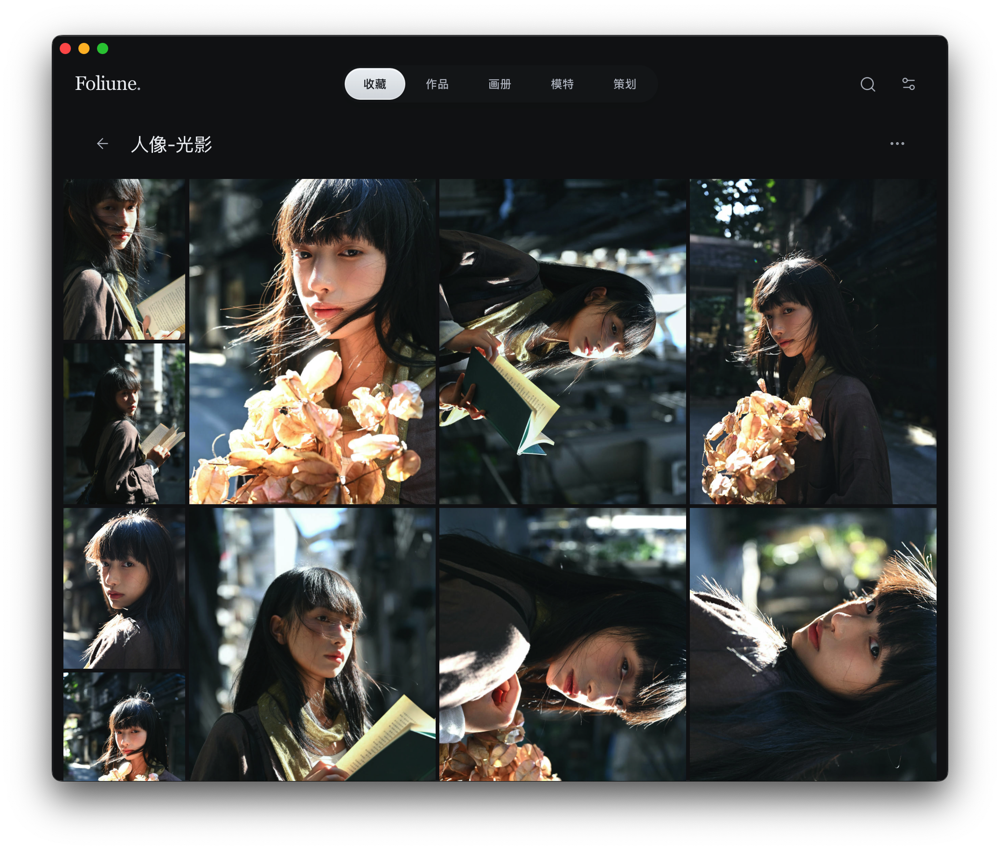
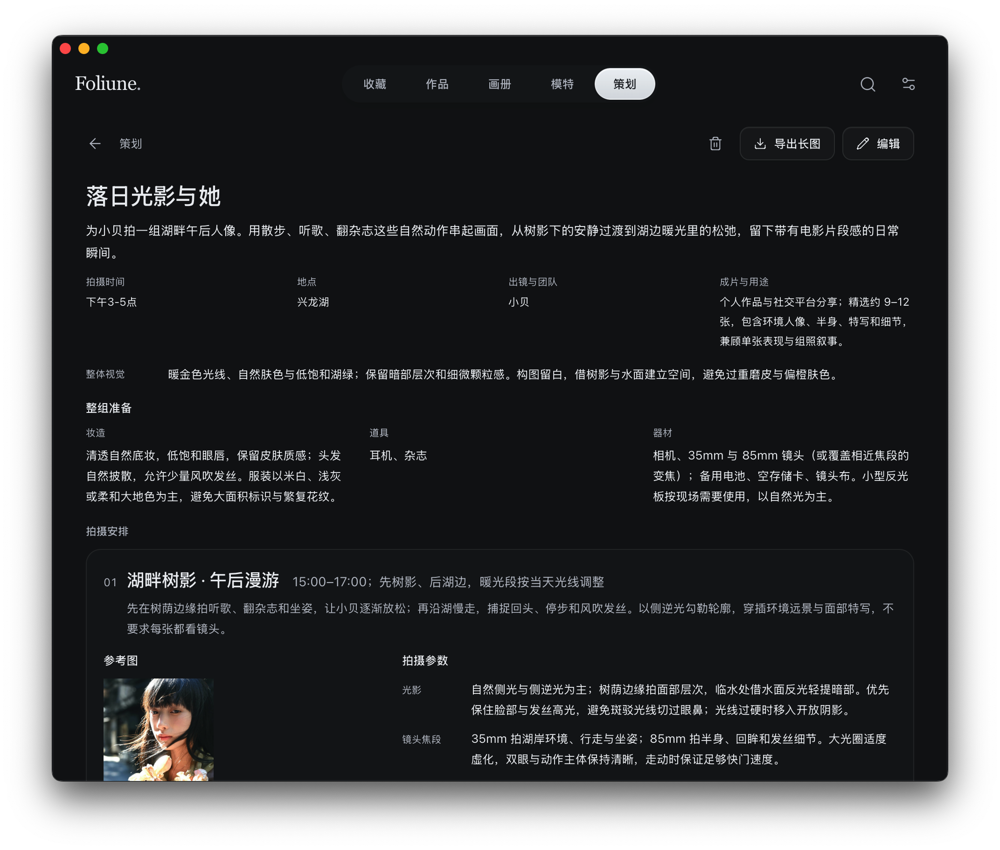

<div align="center">
  
  <h1>Foliune</h1>
  <p><strong>For photographs worth returning to.</strong></p>
  <p><a href="README.md">中文</a> · English</p>
  <p><strong><a href="https://github.com/stardut/Foliune/releases/latest">Download for macOS (Apple Silicon)</a></strong> · <a href="https://stardut.github.io/Foliune/en.html">Visit the website</a></p>
</div>

<br />

Foliune is a local desktop app for photographers and photography enthusiasts. Keep the images you collect and the photographs you make in separate albums. Bring the ones you want to see together into a photobook you can take your time with.



[See releases & installation notes](#get-started)

## From a photograph to a photobook

### Collections & personal work

Keep track of the light, colors, and compositions that caught your eye with tags and written notes. The photo wall gives landscape, portrait, and square photographs room to sit together at their original proportions, with each composition intact.

**Import photos from a post.** In an album, open **Import Photos → Link**, paste the link to a single Xiaohongshu or Instagram post, and choose **Get Photos**. Preview the results, select the photos you want, and click **Import** to add them to the library. Imports depend on access to the post. Foliune saves only still images supplied by the platform and skips videos and their covers.

You can import local photos or go to **Settings → Work Folder** to link a folder on your computer or an external drive. Its immediate subfolders become albums in your work collection, while the originals stay in place. When Foliune finds new photographs, you can sync or ignore them.

Revisit work by shooting region on the offline **Work Map**. In China, provinces can expand into cities and other prefecture-level regions when there is room for their photo cards. Select a representative photograph or a point on the globe to see more work from that region. You can set a region manually for photographs without GPS data.

[See the Work Map](site/assets/works-map.webp)

On macOS, use AirDrop to share the originals of selected photographs or an entire album.

### Photobooks

Choose photographs from your collections and personal work. Start with an automatic layout, then decide which photographs belong side by side and which deserve a page of their own. Break the sequence into chapters and adjust the framing while keeping the originals intact.

Turn one page at a time or view a full spread. When you’re ready to share the book, export it as a standalone HTML file.

[See a photobook spread](site/assets/photobook-spread.webp) · [See the photobook shelf](docs/screenshots/photobook-shelf.jpg)

### Viewing

Give photographs the screen. Play them in order or at random, decide how long to stay with each one, and choose some local music for the session if you like.

## Before the next shoot

### Shoot planning

Bring references and practical details into one plan: the theme, scenes, lighting, and shot list, with styling, props, and equipment gathered in one place. Choose a local folder for the long PNG, then take it along to the shoot on your phone.



### Model profiles

Keep model details and sample photographs together, so you can revisit past shoots and looks when planning another collaboration.

[See model profiles](docs/screenshots/model-profiles.png)

## More ways to create

- **Collages**: combine photographs in adaptive, grid, or long layouts; adjust sequence and framing, then export a PNG to a local folder of your choice.
- **Post previews**: try image and text arrangements for WeChat Moments, Xiaohongshu, and Instagram as temporary previews.

<sub>[Screenshot details & photo credits](docs/screenshots/README.md)</sub>

## Your library stays local

Everyday organization, photobook creation, and viewing require no cloud account. Your library stays on your computer, with support for ZIP backups and incremental restores. Cloud sync is not currently available.

- **Originals preserved**: local imports store the source path and a thumbnail. Full-size viewing reads the source file and shows a missing-file message if the file is gone. Existing managed copies remain in the library. Discarding a photograph affects only its membership in that album.
- **Backups you control**: save just library data and thumbnails in a ZIP, or include all originals from the library, local imports, and your linked work folder.

## Command-line tool

On macOS, move Foliune to Applications, open your library once, and install `foliune-cli` in **Settings → Command-Line Tool**.

Use your terminal or an AI assistant with terminal access to search and edit photos, albums, photobooks, shoot plans, and model profiles in the same local library as the desktop app. For example, search for “window light” in your photos.

```sh
foliune-cli photo search "window light"
```

From there, you can add the photos to an album. You can also select reference photos in a shoot plan on the desktop, then retrieve their previews from the terminal. See the [CLI guide](docs/cli.md) for more commands.

## Get started

For a first install, download the Apple Silicon DMG from [Releases](https://github.com/stardut/Foliune/releases/latest). If you already have Foliune, check for updates in **Settings → App Updates**.

Foliune is still in development, with the following platform and format limits:

| Item | Current scope |
| :--- | :--- |
| Desktop platforms | macOS has verification records; Windows has not been verified. iOS and Android are not currently supported. |
| Release builds | The current release workflow targets Apple Silicon Macs. Check Releases for actual package availability. |
| Photo formats | JPEG, PNG, and WebP. RAW and HEIC are not yet supported. |
| macOS signing | The current release workflow uses ad-hoc signing, without Apple Developer ID signing or notarization. macOS may block the first launch. |

In **Settings → Language**, choose English, Simplified Chinese, or the system setting.

Start with a series you’d like to see again and try arranging it into your first photobook.

## What's ahead

### AI assistance for photographers

Connect to a model API of your choice to analyze light and shadow, color, and composition in your photographs. Use reference images to draft shoot plans and put together shot lists, and get help organizing model profiles and sample photographs.

## About the project

Foliune is free, with plans to become open source. A formal license has not yet been selected, and this repository does not currently grant an open-source license.

[Report an issue](https://github.com/stardut/Foliune/issues) · [Product principles (中文)](docs/product.md) · [Design guidelines (中文)](docs/design.md)
