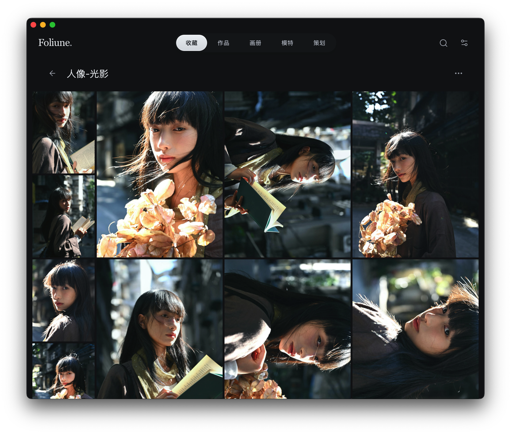
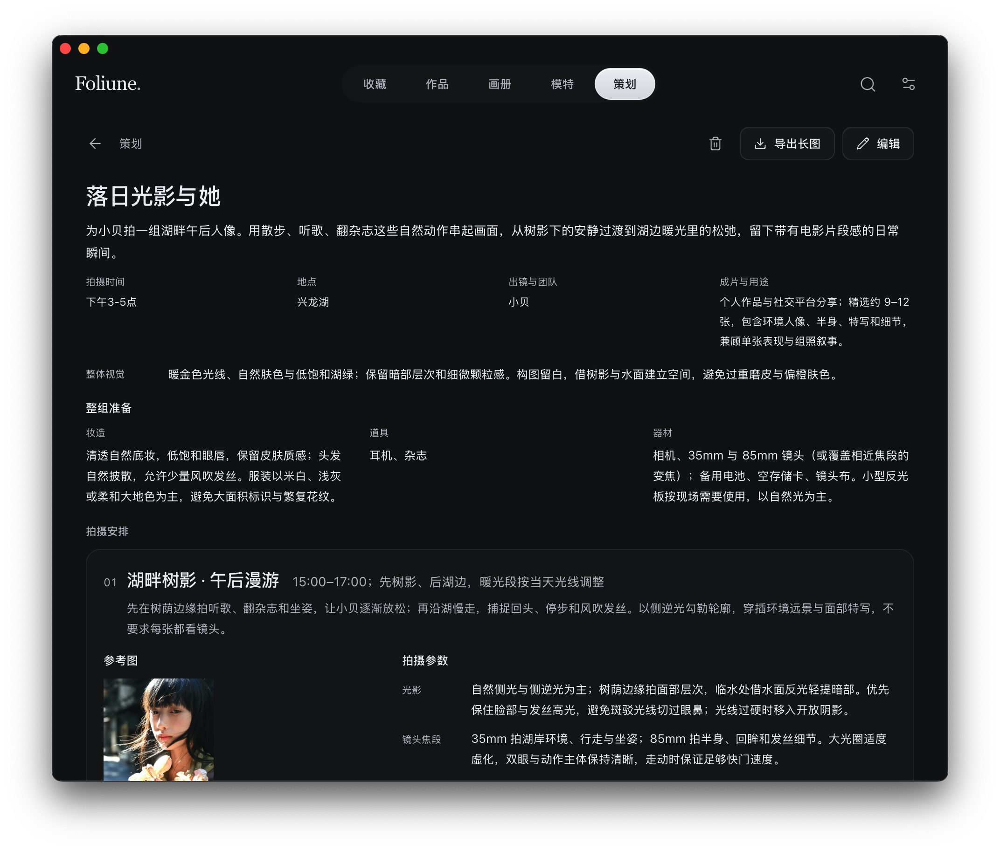

  
  <h1>Foliune</h1>
  
<strong>For photographs worth returning to.</strong>

  
<a href="README.md">中文</a> · English

 

Foliune is a local desktop app for photographers and photography enthusiasts. Keep the images you collect and the photographs you make in separate albums. Bring the ones you want to see together into a photobook you can take your time with.

[See releases & installation notes](#get-started)

## From a photograph to a photobook

### Collections & personal work

Keep track of the light, colors, and compositions that caught your eye with tags, notes, and annotations on the image. The photo wall gives landscape, portrait, and square photographs room to sit together at their original proportions, with each composition intact.

Import local photographs, or preview and select images from individual Xiaohongshu and Instagram image posts before adding them to your library. Link imports depend on platform access and save the static image versions supplied by the platform.

### Photobooks

Choose photographs from your collections and personal work. Start with an automatic layout, then decide which photographs belong side by side and which deserve a page of their own. Break the sequence into chapters and adjust the framing while keeping the originals intact.

Turn one page at a time or view a full spread. When you’re ready to share the book, export it as a standalone HTML file.

[See the photobook shelf](docs/screenshots/photobook-shelf.jpg)

### Viewing

Give photographs the screen. Play them in order or at random, decide how long to stay with each one, and choose some local music for the session if you like.

## Before the next shoot

### Shoot planning

Bring references and practical details into one plan: the theme, scenes, lighting, and shot list, with styling, props, and equipment gathered in one place. Choose a local folder for the long PNG, then take it along to the shoot on your phone.

### Model profiles

Keep model details and sample photographs together, so you can revisit past shoots and looks when planning another collaboration.

[See model profiles](docs/screenshots/model-profiles.png)

## More ways to create

- **Collages**: combine photographs in adaptive, grid, or long layouts; adjust sequence and framing, then export a PNG to a local folder of your choice.
- **Post previews**: try image and text arrangements for WeChat Moments, Xiaohongshu, and Instagram as temporary previews.

[Screenshot details & photo credits](docs/screenshots/README.md)

## Your library stays local

Everyday organization, photobook creation, and viewing require no cloud account. Libraries are stored on your computer, with support for switching between libraries and ZIP backup and restore. Cloud sync is not currently available.

- **Originals preserved**: local imports store the source path and a thumbnail. Full-size viewing reads the source file and shows a missing-file message if the file is gone. Existing managed copies remain in the library. Discarding a photograph affects only its membership in that album.
- **Backups you control**: backups include library data, managed photographs, thumbnails, and photobooks. Keep a separate backup of external originals.

## Get started

See [Releases](https://github.com/stardut/Foliune/releases) for versions and installation notes. Foliune is still in development, with the following platform and format limits:

| Item | Current scope |
| :--- | :--- |
| Desktop platforms | macOS has verification records; Windows has not been verified. iOS and Android are not currently supported. |
| Release builds | The current release workflow targets Apple Silicon Macs. Check Releases for actual package availability. |
| Photo formats | JPEG, PNG, and WebP. RAW and HEIC are not yet supported. |
| macOS signing | The current release workflow uses ad-hoc signing, without Apple Developer ID signing or notarization. macOS may block the first launch. |

Start with a series you’d like to see again and try arranging it into your first photobook.

## What's ahead

### AI assistance for photographers

Connect to a model API of your choice to analyze light and shadow, color, and composition in your photographs. Use reference images to draft shoot plans and put together shot lists, and get help organizing model profiles and sample photographs.

### A map of your work

Browse your work by shooting location. See photographs from Xinjiang, Beijing, and elsewhere on the map, then select a place to revisit the work you made there.

### Command line & personal assistants

Use a command-line interface (CLI) to let external agents help organize photographs, edit photobooks, update model profiles, and draft or review shoot plans. Connect a personal assistant to get a reminder at a time you set before a shoot.

## About the project

Foliune is free, with plans to become open source. A formal license has not yet been selected, and this repository does not currently grant an open-source license.

[Report an issue](https://github.com/stardut/Foliune/issues) · [Product principles (中文)](docs/product.md) · [Design guidelines (中文)](docs/design.md)
