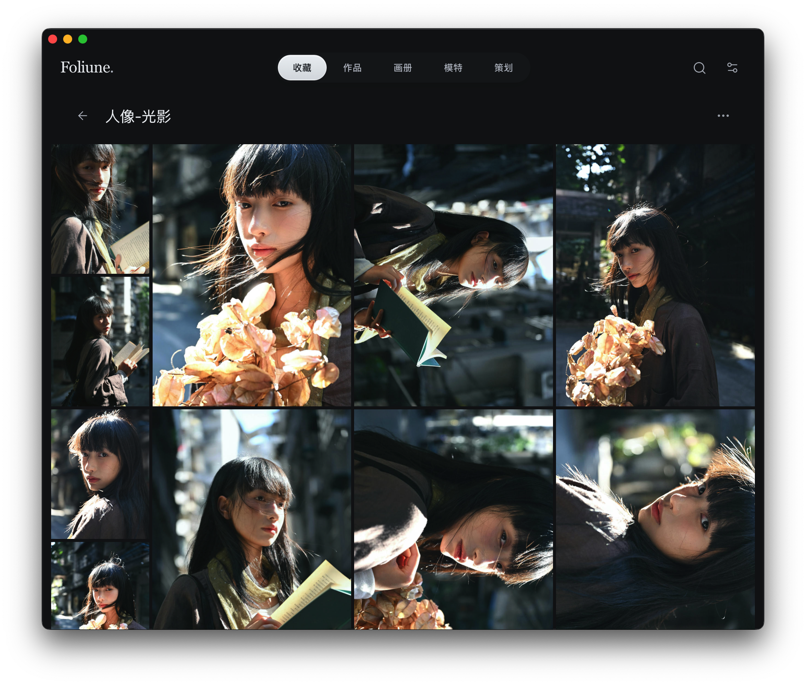
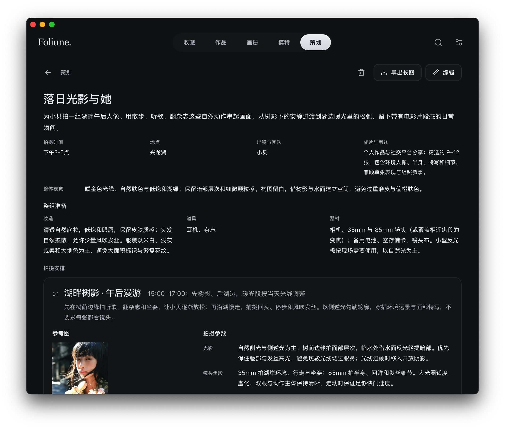

  
  <h1>Foliune</h1>
  
<strong>For photographs worth returning to.</strong>

  
献给值得反复回看的照片。

  
中文 · <a href="README.en.md">English</a>

  
<a href="https://stardut.github.io/Foliune/">访问官网</a>

 

Foliune 是一款面向摄影师和摄影爱好者的本地桌面应用。把喜欢的影像和自己的作品分开收藏，从中选出想放在一起的照片，编成一本可以慢慢翻看的画册。

[查看版本与安装说明](#开始使用)

## 从一张照片，到一本画册

### 收藏与作品

为参考图和自己的作品分别建立相簿。用标签和文字标注，记下吸引你的光线、颜色或构图。横幅、竖幅和方形照片在同一面照片墙上保留各自的比例与完整构图。

支持导入本地照片，也可从小红书、Instagram 的单篇帖子中预览选片，确认后再加入图库。链接导入取决于平台访问条件，只保存平台提供的静态照片，跳过视频及其封面。

在「设置 → 作品目录」绑定本机或移动硬盘上的目录，可把一级子文件夹收录为作品相簿。照片留在原位置，发现新照片时可以选择同步或忽略。

在 macOS 上，可以从相簿投送选中的原片，也可以隔空投送整本相簿。

### 画册

从收藏和作品中选片，先自动排版，再逐页决定哪些照片并排、哪一张值得单独留一页。用章节分开不同段落，调整取景时保留照片原件。

可以单页慢慢翻，也可以并排看一整个跨页。想把画册交给别人看，就导出为可独立打开的 HTML 文件。

[查看画册书架](docs/screenshots/photobook-shelf.jpg)

### 欣赏

想单纯看照片时，就让照片占据屏幕。按顺序或随机播放，自己决定每张停留多久，也可以为这次欣赏选一段本地音乐。

## 为下一次拍摄做准备

### 拍摄策划

从参考影像到现场安排，在一份策划中梳理主题、场景、光线与镜头清单，集中准备妆造、道具和器材。选择本地目录导出 PNG 长图，方便带到拍摄现场用手机查看。

### 模特档案

把模特资料和样片放在一起，下次准备合作时，可以回看之前的拍摄和适合的风格。

[查看模特档案](docs/screenshots/model-profiles.png)

## 更多创作方式

- **拼图**：以自适应、网格或长图组合选片，调整顺序与构图，导出 PNG 到你选择的本地目录。
- **发布预览**：模拟朋友圈、小红书与 Instagram 帖子的图文排布，仅作临时预览。

[截图与摄影来源](docs/screenshots/README.md)

## 照片留在本地

日常整理、画册制作与欣赏无需云端账户。图库保存在本机，支持 ZIP 备份与增量恢复，目前不提供云同步。

- **保留原件**：本地导入保存源文件路径和缩略图，打开大图时读取原位置。找不到源文件时会显示提示。此前已经入库的管理副本继续保留。从相簿中废弃照片只改变该相簿关系。
- **自行备份**：导出 ZIP 时可只保存图库数据和缩略图，也可一起备份全部原片，包括本地导入和作品目录引用的文件。

## 开始使用

版本与安装说明请查看 [Releases](https://github.com/stardut/Foliune/releases)。当前仍处于开发阶段，平台与格式边界如下：

| 项目 | 当前范围 |
| :--- | :--- |
| 桌面平台 | 已有 macOS 验证记录；Windows 尚未验证，iOS 与 Android 暂不支持 |
| 发布构建 | 面向 Apple Silicon Mac，安装包以 Releases 为准 |
| 照片格式 | JPEG、PNG、WebP；暂不支持 RAW 与 HEIC |
| macOS 签名 | 当前发布流程采用 ad-hoc 签名，未经 Apple Developer ID 签名或公证，首次打开可能受系统限制 |

第一次使用，可以先导入一组你想重新看的照片，再试着把它们排成一本画册。

## 后续规划

- **AI 摄影助手**：接入自选的大模型 API，从光影、色彩和构图等角度分析照片。结合参考图起草拍摄策划、梳理镜头清单，也能协助整理模特资料和样片。
- **作品地图**：按拍摄地点在地图上浏览作品相簿，直接看到新疆、北京等地各有哪些作品，点开地点即可回看那里的照片。
- **CLI 与个人助理**：通过命令行让外部智能代理（Agent）协助整理照片、编辑画册、维护模特档案，以及起草和审阅拍摄策划。也可接入个人助理，在拍摄开始前按约定时间提醒。

## 关于项目

Foliune 免费，计划开源。正式许可证尚未确定，当前仓库尚未授予开源许可。

[反馈问题](https://github.com/stardut/Foliune/issues) · [产品约定](docs/product.md) · [设计规范](docs/design.md)
