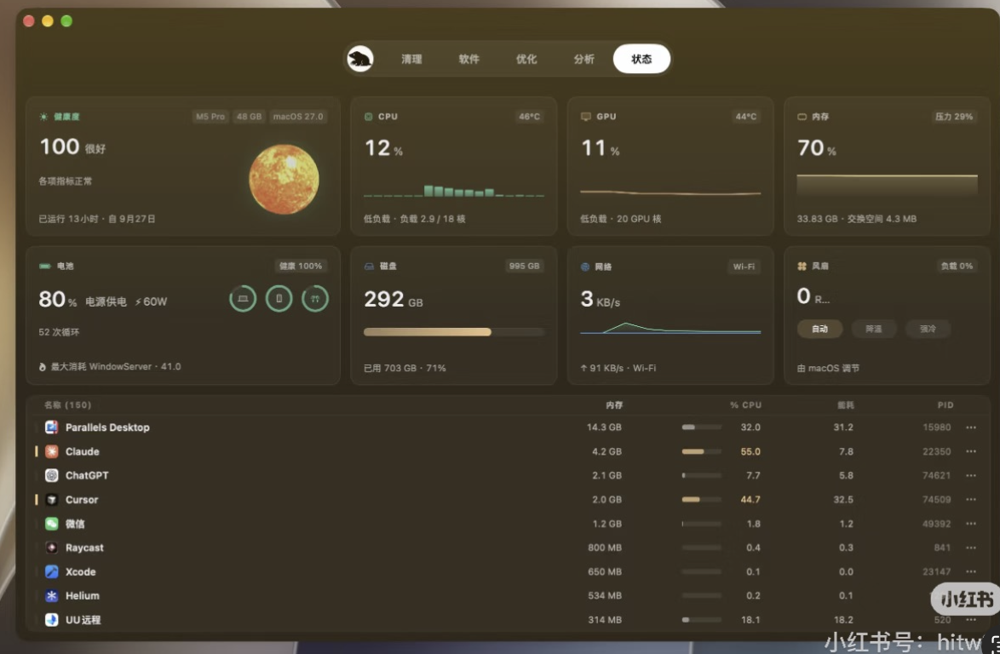

# Foliune 设计规范

## 定位与适用范围

本规范于 2026-10-30 根据用户确认的样式方向制定，是后续 UI 方案、开发、代码审查与设计验收的依据。它将 [AGENTS.md](../AGENTS.md) 中“高级”与“设计感和质感”具体化；产品行为仍遵循 [产品约定](product.md)。

**样式基调：统一的中性深色、真实系统毛玻璃、连续背景、克制形态与精致控件，形成沉静、有工艺感的摄影桌面应用。**

2026-10-30 用户在首轮实现后明确要求：背景须能透出桌面壁纸；减少背景色块及线段分割，改善配色。此修订取代首轮偏棕绿的多层面板方向。用户参考图继续作为材质和完成度参考；实施与验证见 [系统毛玻璃修订](system-glass-refinement.md)。

随后经同首页材质对照，用户明确选择 **B · 熏黑玻璃**：连续中性深色外壳、克制的顶部入光与细内缘、轻微相簿承托、凹入导航槽和精细金属控件。通过材质职责与局部光影形成层次，不靠壁纸提供全部质感，不用贯穿窗口的斜向渐变。浅、深与复杂背景下都须检查稳定明度、照片优先和操作可读；浏览器对照的选定不等于原生效果已验收。见[B方案原生落地](material-b-implementation.md)。其中导航方向于 2026-11-02 按用户要求改为自然悬浮的轻盈通透胶囊；首轮较厚、较实的外框已被用户否定，第二轮上方线条仍过重，当前保持原版紧凑比例，以无描边、无内顶光的轻薄外框和单层柔影承托浅色选中面。此修订仅限导航，见[悬浮胶囊导航](floating-navigation.md)。

用户后续明确要求更深基底及整个背景区域的光泽变化：光照采用相对窗口尺度的中性宽缓漫反射和暗部过渡，不仅限于顶部短光；保持单一连续色系，禁止用硬边或分区色块替代过渡。系统壁纸参与和可控表面光泽分别判断，均不得污染照片与纸张。见[背景深度与整面光泽](background-sheen.md)。

用户提供的截图是视觉方向参考，[CleanMyMac](https://macpaw.com/cleanmymac) 是材质与控件完成度参考。提取其层次、比例、色彩关系和细节精度，布局须服务于 Foliune 的摄影浏览与画册场景。

参考图来自用户提供的截图，产品身份和具体实现方式未核实。截图用于观察视觉关系，不能证明透明材质、动效或交互的实际效果，也不是 Foliune 的实现或验收截图。

本规范确定目标，不代表当前界面已经达标。制定时现有工作区仍以浅中性色为主；旧文档和验收记录中的浅色界面属于历史证据，不再作为后续样式方向。界面迁移按已授权任务分轮实施，本规范本身不要求立即改造所有页面，也不改变当前技术路线。

## 应用图标

2026-11-01 用户最终接受纯黑背景、柔白连续曲线 F 的视觉稿。接入以确认的原始 PNG 为准，不再改动 F 的造型、色彩或表面；仅进行系统图标所需的等比缩放、圆角裁切及透明外留白处理。此前几何 C、厚边材质与折面稿均为历史探索，不作为当前设计依据。小尺寸需保持识别，背景不增加微光、渐变、纹理或描边。此规则针对软件应用图标，不据此改动界面字标或已认可字体。确认原稿及生成验证见[应用图标记录](design-assets/app-icon-study/README.md)。

## 1. 整体气质

采用低饱和的中性烟灰深色体系，呈现安静、从容、有厚度的视觉感受。壁纸通过真实系统材质自然参与色温，通过协调的比例、细腻的材质与完整的细节体现高级感。

页面保持适当信息密度，留白服务于内容组织和观看节奏。窗口、面板、菜单、弹窗和状态反馈属于同一套设计语言；局部精致与整体协调须同时成立。

## 2. 色彩与层次

- 应用外壳以单一中性烟灰透明底色为方向；导航与内容共享连续基底，控件和临时浮层沿用同一色相，以少量透明度及明度变化建立层级。避免棕绿混杂的渐变、逐区换底和重复照片托底。
- 正文使用柔和浅色，次要信息适度降低明度，同时保证可读性。低对比用于表面分层，文字、焦点和必要操作反馈须保持清晰。
- 强调色少量使用，与底色协调。主操作、选中态和业务状态分别建立稳定规则；错误与警告保留可辨识的语义，并结合文字或图标表达。
- 摄影展示区域采用接近中性的背景，避免暖色底干扰照片色彩判断。画册纸张及独立 HTML 导出服从画册设计，与应用外壳隔离。

具体色值须在代表页面与真实摄影内容中确定并记录为统一变量。参考图的模糊、压缩与环境色不作为精确取色依据。

## 3. 材质与光影

- 用户明确的“雨天玻璃”指自然、不规则的光影、散射和通透变化。不得将其具象化为水滴、水痕、雨景贴图；材质变化须低对比、连续、无可命名图案，保持烟黑深度与照片优先。避免规则渐变光带，也不以云雾装饰背景替代材质。后续试验已证实程序密度场仍会形成雾团，用户明确要求移除；窗口背景不得再以噪声场、静态透射图或渐变模拟自然通透，变化来自真实系统材质与背后内容。保持当前深度，桌面本身均匀时不人为补图案。见[恢复系统深色玻璃](native-smoke.md)，此前[散射试验](glass-scattering.md)仅作历史证据。
- macOS 应用背景采用真实系统毛玻璃，能透出桌面壁纸；透明宿主、系统材质和前端透明基底须一起生效，不能以窗口内 CSS 模糊冒称完成。其它平台按实际支持与验证结果记录。
- 大面积背景连续、安静，优先用间距与排版组织内容。相簿及功能分区减少装饰描边、重复底板和横向分割线；控件与临时浮层可用细微高光及阴影表达触感，必要表单边界、选择和焦点反馈保持清晰。
- 光影方向、强度和层级统一：窗口材质承载页面，内容通过布局组织，控件提供操作，浮层表达临时关系。
- 半透明与背景模糊按场景使用，保证文字、照片和操作清晰。区分窗口内模糊与系统窗口透光材质，按实际实现和平台验证结果描述。
- 材质须在真实应用、不同窗口尺度与背景条件下检查；持续模糊、大面积阴影等效果须检验滚动与响应表现。

2026-11-03 用户明确要求策划的每个场景为独立卡片。该页面采用单层浅中性深色底、可辨细边界与克制圆角建立场景归属；卡内“参考图 / 拍摄参数 / 镜头清单”靠标题和间距分层，不再套多个底板或重阴影。此要求优先于早期策划“不新增底板”的历史方案。见[场景卡片与整组准备](planning-scene-cards.md)。 用户后续确认导出PNG采用连续中性白纸与场景章节，以浅细线、标题及间距区分，取消灰底和卡片轮廓；此变更仅限长图，应用内卡片保留。见[连续纸张长图](planning-paper-export.md)。

## 4. 圆角与形态

窗口、面板、按钮和输入框采用有层级的圆角规则，按尺寸与用途确定曲率。圆角克制、轮廓柔和利落；嵌套容器的内外圆角与间距相互协调。

胶囊形用于合适的分段导航或状态切换。普通按钮、卡片和内容容器保留各自清晰的形态。具体圆角尺度在基础组件中统一定义，避免逐页另设数值。

## 5. 按钮与控件

2026-10-31 用户明确导航应为有质感的胶囊式，可参考CleanMyMac，取代此前网页标签/短下标候选；已认可的无衬线字体、相簿卡片与背景保持。2026-11-02 用户要求自然悬浮、轻盈通透，否定首轮厚重外框并认为原版更好，随后指出第二轮上方线条感仍重。导航保持 2px 内留白和 40px 外高，当前为无描边、无内顶光的轻薄外框，以低对比半透明中性暗面及单层柔影承托浅色选中胶囊；透明 1px 边框只作几何占位，不增加厚亮边或多层黑投影，现有液态切换保持。见[悬浮胶囊导航](floating-navigation.md)。主按钮以小胶囊呼应，浅面深字，次按钮低调，状态清楚。

实施与验收见[胶囊控件](capsule-controls.md)。此前[文字导航](control-detail.md)、[现代控件](modern-controls.md)仅作迭代证据，不将旧候选通过当用户最终认可。任何精修不应擅自改变已认可字体、卡片或背景。

- 2026-11-03 按用户要求，页面右上角的新建入口（收藏与作品的新建相簿、书架的创建画册、模特的新建档案）统一复用页面空态的深色细边框圆角 `button`；浅色胶囊 `button-primary` 继续用于保存、确认等流程主操作。
- 统一设计填充、轮廓、高光、图标、文字、内边距与点击范围。主操作形成清晰焦点，次操作融入面板，图标按钮的尺寸与视觉重量保持一致。
- 默认、悬停、按下、选中、禁用与键盘焦点状态完整可辨。选中或焦点须有清晰依据，不能仅依靠几乎不可见的色差。键盘焦点依据真实输入方式显示，鼠标点击及程序恢复焦点不绘制整图白框；图片键盘定位使用克制细边，与已选照片边界区分。不得以全局禁用焦点轮廓解决鼠标残留。
- 输入框、菜单、滑块、开关和弹窗沿用相同材质与形态规则。按组件适用场景覆盖加载、成功和失败反馈。
- 2026-11-02 按用户反馈，输入与选择控件不得在获得焦点后出现粗白外圈；统一使用沿原边界或内缘的克制灰蓝反馈，保留清楚的键盘定位。按钮及离散控件区分鼠标与键盘输入，不能以全局 `outline: none` 代替设计。模拟平台使用平铺单选，具体审计和验证见 [控件焦点与平台单选](form-focus-platform.md)。
- 图标笔画、尺寸和基线统一；图标按钮具有可访问名称。视觉上的克制不能缩小必要点击范围或隐藏关键操作。

## 6. 排版与布局

相簿名称按2026-10-31用户反馈统一为现代系统无衬线，与按钮/导航一致；不用衬线字体营造名称的设计感，以字号、字重和留白建立层级。此前衬线名称试验仅作历史记录。见[现代控件精修](modern-controls.md)。

建立稳定的字体、字号、字重、行高与间距尺度。标题、正文、元数据和操作标签各司其职，数值列按需使用等宽数字。字体选择以真实中英文内容的可读性与协调性判断。

通过对齐、分组、间距与简短命名表达结构，减少重复说明与装饰性文字。保留必要空态、错误、风险确认及可访问名称。

面板边缘、标题起点、图片边界和操作区域保持有意识的对齐。宽窗与窄窗下均维持协调比例、舒适密度和可达操作。全局字体与控件调整须隔离画册纸张和独立导出，纸张内部文字尺寸服从画册布局。

## 7. 摄影作品与操作的关系

照片在浏览与欣赏场景中获得主要空间与视觉权重，界面材质衬托作品。图库展览保持原比例与完整构图；画册裁切遵循已有非破坏性规则。

相簿首页按用户要求采用上图下字的一体卡片：封面占主要面积并满铺上部，文字位于同一卡片底部；名称具有明确展示层级，数量低调。封面预览允许等比裁切以填满区域，这是overview入口的特例，不延伸到照片墙、单张审片或原图。

照片边框、阴影和背景依据场景统一处理。照片墙在浏览模式下不显示悬浮选择框和三点按钮，右键菜单或键盘菜单承担照片操作。首次从菜单选中后才进入选择模式并显示必要选择反馈，退出后恢复干净浏览；批量操作栏可保留更多入口。菜单及模式切换遵循产品约定；菜单对象与批量范围明确。界面外壳可以表达材质，照片像素本身保持忠实。

## 8. 动效与状态

悬停、按下、切换和展开保持一致节奏，以短促、连贯、及时的反馈帮助理解状态和空间关系。动效幅度克制，支持系统减少动态效果偏好。

照片、选择栏等关键内容默认可见；关闭、清选与切换后直接条件卸载。业务正确性和可见性不能依赖动画完成，须在原生 WebView 检查可见、可关闭、无残留。

## 9. 实施与验收

### 开发前

1. 阅读本规范，检查目标页面、相关样式、现有变量和基础组件。当前入口包括 `apps/desktop/src/index.css` 与 `apps/desktop/src/components/ui.tsx`，并按任务检查功能样式。
2. 写清场景、审美意图、照片与控件主次、关键状态及验收范围。重要页面先形成可检查的方案，小修复简要记录。
3. 说明新增样式与现有体系的关系。颜色、圆角、阴影、描边、间距与控件状态集中维护；组件与变量先验证代表页面，再按本轮范围推广。

### 验收依据

功能与设计分别记录结论，开发与独立验收分工沿用 AGENTS.md。逐项检查本轮涉及的维度：

| 维度 | 通过依据 |
| --- | --- |
| 材质 | 背景、面板、控件层次细腻一致，光影协调，文字和作品清晰，浮层边界可辨。 |
| 色彩 | 配色统一，正文、次要信息与焦点可读，状态可辨，照片观感不受暖色外壳干扰。 |
| 形态与排版 | 圆角、嵌套、间距、对齐与文字层级协调，宽窄窗口无意外截断、遮挡或不可达操作。 |
| 控件与状态 | 适用的默认、悬停、按下、选中、禁用、焦点、加载、空态和异常状态完整，键盘路径可用。 |
| 作品呈现 | 使用真实混合比例摄影，检查首段、中段和末尾；展览构图完整，画册纸张与导出样式不受全局污染。 |
| 动效与响应 | 原生 WebView 中状态反馈连贯、响应及时，减少动态效果可用，关闭与切换无残留。性能结论使用 release 实测。 |
| 整体一致性 | 页面、菜单、弹窗和基础组件属于同一视觉语言，与方案及前后对照一致。 |

真实桌面验收保留截图、必要录屏与交互检查记录，注明实例/版本、平台、窗口尺度、摄影样本、步骤、结果和限制；记录方式参见 [桌面验收记录](desktop-verification.md)。使用独立图库、测试材料或已授权副本。

自动测试或构建通过不代表设计通过，静态截图不能替代动效与真实交互验收。未通过项返修后复验；无法验证的项明确标为未验证。旧浅色界面的通过记录不能证明新规范已通过，macOS 结论也不推定其他平台通过。
